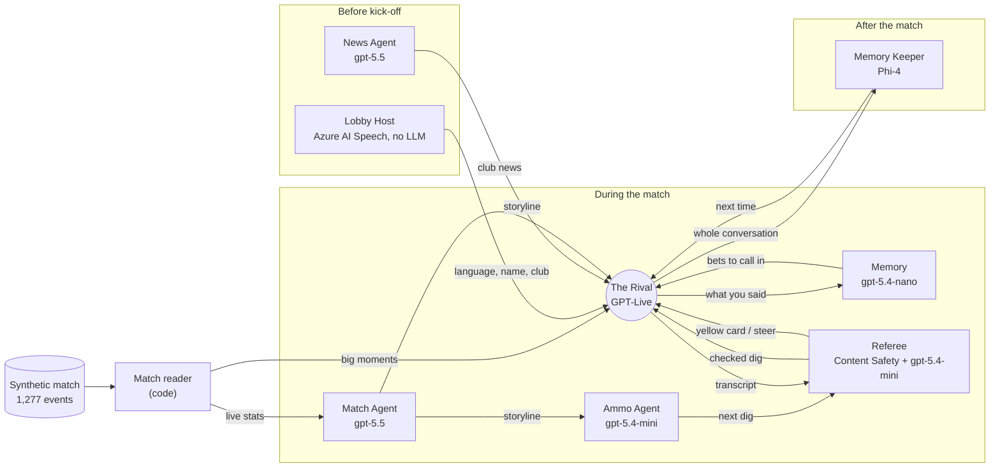

# Nemesys

**Enjoy football with a rival.** Nemesys is an AI rival fan you talk to while a match is on: a fan of the *other*
club, who watches with you, winds you up, celebrates their goals in your ear, makes bets with you, remembers what you
said last time, and throws it back at you. It is **audio only**: you just talk.

Built for the Microsoft x Premier League *Inside the Game* hackathon. Every club, player and match is fictional.

**Try it:** https://nemesys.victoriouswater-295fb226.swedencentral.azurecontainerapps.io
**Watch the demo:** *(video link added at submission)*

### Trying it

1. Use **Chrome or Edge** on a laptop or desktop, with **headphones** and a **microphone**. Headphones matter: on
   speakers, the microphone hears the rival too.
2. Press **Connect** and allow the microphone.
3. The host asks for your **language**: say "English" (or "中文", or "Español").
4. Tell the host your **name**, then the **club** you support: "Kilburn" or "Harbour City".
5. Pick a **rival** by name. They'll greet you, and the match kicks off a minute later.
6. Talk the whole way through: wind them up, make a bet, ask what's just happened, ask who'll win the league.
   A match takes about 15 minutes; stay to the end for your match report.

If the host doesn't catch you, the choices on screen can also be tapped. Voice minutes are capped each day; if the
rival says it's busy or the day's minutes are used up, please try again later.

> **The demo view.** Nemesys has no screen. What you see in the demo is a window onto what's happening behind the
> voice: the conversation as captions, the match, and the agents at work. A listener only ever hears the rival.

## Why

Football is better with someone to argue with. But plenty of fans watch alone: abroad, far from friends, or with no
one at home who supports the other side. And sometimes you **can't watch at all**: on a train, driving, at work.
Nemesys works for both:

- **Alongside the match on TV**, it's the rival on the sofa next to you.
- **When you can't watch**, it's your eyes on the match: ask "what's just happened?" and your rival tells you, in
  character, from the live match data.
- **In your language.** English, Mandarin or Spanish, chosen by voice in the lobby, with a rival who speaks it.

## What it does

- **A voice lobby.** The host asks your language, your name and your club, then matches you with a rival who
  supports the other side and speaks your language: a rematch with last time's rival, or someone new.
- **A real conversation.** The rival runs on **GPT-Live**, which listens and talks at the same time (full duplex):
  you can interrupt, it can cut in when a goal goes in, and nobody waits for a turn.
- **It knows the match.** Big moments break into the conversation as they happen; the rival can look up the score,
  possession, shots and cards at any time, and knows the whole league table.
- **It remembers you.** Bold claims, bets and predictions are noted as you make them, called in when the match
  settles them, and kept for next time, with the running jokes between you.
- **It stays good-natured.** A Referee checks every line you say (yes, you can get a yellow card) and steps in if the
  rival goes too far.
- **A match report at full time**: the three moments that decided it and why they mattered, and your bets settled.

## The agents

Nemesys is one voice and seven agents behind it, each with its own job and its own model.



| Agent | Job | Model | Why this model |
|---|---|---|---|
| **Lobby Host** | Asks your language, name and club; finds you a rival | Azure AI Speech (multilingual voice, speech recognition in three languages), **no LLM** | A fixed conversation: rules are instant and never go off script. |
| **News Agent** | Writes the fortnight's club news before kick-off | **gpt-5.5** | Runs once per match: quality over speed. |
| **Match Agent** | Reads the stats into storylines; writes the full-time report | **gpt-5.5** | Must never state a wrong fact. |
| **Ammo Agent** | Picks the next dig when the conversation lulls: the news, the table, your own words | **gpt-5.4-mini** | Wit and judgement, quick enough for a lull. |
| **Memory** | Notes bets (two-way: whoever loses pays) and predictions as they're made | **gpt-5.4-nano** | Best at this structured extraction, and cheapest. |
| **Referee** | Checks every dig before the rival says it; books you for abuse; steers the rival | **Azure AI Content Safety**, then **gpt-5.4-mini** | Content Safety is the fast gate for anything severe; the model tells banter from abuse, which Content Safety can't. |
| **The Rival** | Watches with you and talks | **GPT-Live** (gpt-live-1) | The only model that listens and talks at once. |
| **Memory Keeper** | After the match: your nickname, running jokes, what you're touchy about | **Phi-4** (Microsoft) | Nobody is waiting, and it's small and private: the kind of job that could run on your own phone. |

**How the models were chosen.** Each agent was tested on its own job, with its real instructions, against the
candidate models deployed in Microsoft Foundry (GPT-5.5, GPT-5.4 mini and nano, Phi-4, Phi-4-mini, Phi-4-reasoning,
and Content Safety alone). Method and results: [evals/README.md](evals/README.md) and
[evals/RESULTS.md](evals/RESULTS.md).

### How they work together

- **Shared state.** One *watch* per viewer holds the match, the conversation, the memory and every agent's latest
  work. Agents read it, add to it, and hand work on: the Ammo agent's dig goes to the Referee before it reaches the
  rival; the Memory's bets come back to the rival when the match settles them.
- **Steering a live voice.** The background agents never speak. They steer GPT-Live through its sideband: big moments
  as commentary to react to, news and storylines as quiet context, the Referee's steer as an instruction. Anything
  sent mid-sentence makes GPT-Live drop the sentence, so everything except a big moment waits for a pause.
- **The match waits for the rival.** After a goal, the clock holds until the rival has finished reacting, so it never
  falls behind and celebrates a goal VAR has already ruled out.
- **Recovering from failure.** The voice reconnects on its own if the connection drops (the match carries on, and
  the rival picks up where it left off). If an agent fails or is slow, its job falls back: the News agent to the
  last good stories, the Ammo agent to rule-based digs; and if the Referee's model doesn't answer, Content Safety's
  gate still stands. A content filter stopping one of the rival's lines doesn't end the match.

### The challenge's five stages

| Stage | In Nemesys |
|---|---|
| **Ingest** | 1,277 synthetic match events (passes, shots, tackles, cards, VAR) streamed live |
| **Interpret** | The match reader turns them into live stats and salience; the Match agent into storylines |
| **Explain** | The rival explains in conversation why a moment matters; the full-time report says why the three key moments did |
| **Render** | Spoken by the rival's voice (and, for the demo, captions, the timeline and the report) |
| **Personalise** | Your club, your language, your rival, your words and bets remembered across matches |

## The data

The rules ask for synthetic data, so Nemesys makes its own: **the Meridian League**. Two clubs in full (Kilburn
Athletic, a patient passing side, and Harbour City, a counter-attacking one), with squads, traits and styles; the
other 18 exist in a table produced by simulating eight matchweeks, so the numbers add up. The match is simulated from
each club's style (Kilburn really keep about 70% of the ball; Harbour City really score on the break) with story
beats planted on top: a VAR penalty, a red card, a goal ruled out, and a comeback from 0-2 to 3-2 in stoppage time.
Club news is written fresh each match by the News agent. The same seed always produces the same match.

## Running it

Needs Python 3.11+, Node 20+ and a Microsoft Foundry resource (AI Services) with these deployments: `gpt-live-1`,
`gpt-5.5`, `gpt-5.4-mini`, `gpt-5.4-nano` and `Phi-4`. Speech, Translator and Content Safety use the same resource.

```bash
pip install -e ".[dev]"
cp .env.example .env            # add the Foundry endpoint and key
cd web && npm install && npm run build && cd ..
python -m kickoff serve         # then open http://127.0.0.1:8000 and press Connect
```

You'll need speakers and a microphone (headphones are best). For working on the screen without paying for a voice:

- `/?dry=1&auto=1`: the real match and agents, with a text stand-in for the rival's voice.
- `/?replay=last&auto=1`: a recorded session played back exactly, with no model calls at all.

### On Azure

The live demo runs on **Azure Container Apps** (one container: the web page and the server), built with
`az acr build` from the `Dockerfile`. Secrets are Container Apps secrets. Because GPT-Live is billed by the second,
the deployment sets two guards: `KICKOFF_MAX_VOICES` (rivals talking at once) and `KICKOFF_DAILY_VOICE_MINUTES`
(minutes of voice per day); a reconnect mid-match is always allowed.

Tests run offline, with no keys: `pytest` (Python) and `cd web && npm test` (web). The Python package is called
`kickoff`, the project's working name.

## Repository

| Path | What's there |
|---|---|
| `src/kickoff/rival.py` | The watch: lobby, match direction, the rival's voice session, memory |
| `src/kickoff/rival_agents.py` | The agents: Match, Ammo, Memory, Referee, Memory Keeper |
| `src/kickoff/news.py` | The News agent |
| `src/kickoff/lobby_lines.py` | What the lobby host says, in three languages |
| `src/kickoff/safety.py`, `translate.py`, `speech.py` | Azure AI Content Safety, Translator and Speech |
| `src/kickoff/match_reader.py`, `generator.py`, `world.py` | The synthetic league, match and live reading of it |
| `src/kickoff/agents/llm.py` | Which model each agent uses, on Microsoft Foundry |
| `web/src/rival/` | The demo view (React) |
| `evals/` | Choosing a model for each agent |
| `tests/` | Offline tests |

Built with Microsoft Foundry, Microsoft Agent Framework, GPT-Live, Azure AI Speech, Azure AI Translator and Azure AI
Content Safety.
